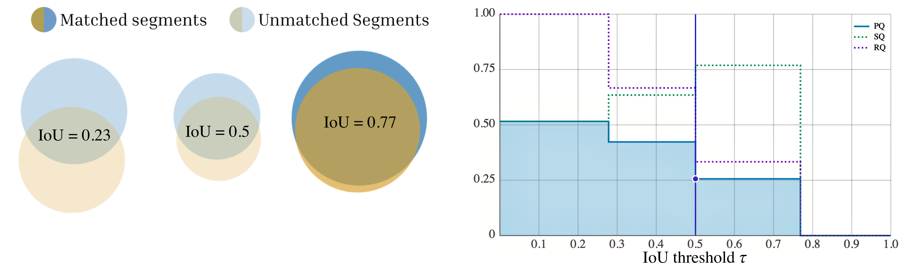

## Interactive playground to explore PQ across different thresholds and matching strategies
[koflerlab.org/panoptica-interactive](https://koflerlab.org/panoptica-interactive/?refs=0.238%2C0.401%2C0.092%3B0.731%2C0.421%2C0.117%3B0.485%2C0.416%2C0.075&preds=0.234%2C0.542%2C0.092%3B0.728%2C0.456%2C0.108%3B0.488%2C0.481%2C0.073&matcher=greedy&mode=scene&sap=0&autc=1&asq=0&arq=0)


## Notebook demonstrating vertebral segmentation 
[Notebook vertebral](./example_vertebral.ipynb)


## Notebook demonstrating part aware liver segmentation 
[Notebook part aware liver](./example_liver.ipynb)


## Notebook demonstrating BraTS metastasis segmentation
[Notebook metastasis](./example_brats_mets.ipynb)

## Implementation
One-to-One, Many-to-One, Vornoi-Region-Wise and AUTC are implemented in the latest release of [Panoptica](https://github.com/BrainLesion/panoptica), experimental One-to-Many can be found on this [fork](https://github.com/ErikGro/panoptica/tree/One-to-Many).

## Citation
Erik Großkopf*, Soumya Snigdha Kundu*, Hendrik Möller, Nicolas Münster, Mehdi Astaraki, Paula Tamara Buzduga, Kerstin Ritter, Benedikt Wiestler, Jan Kirschke, Jonathan Shapey, Tom Vercauteren and Florian Kofler (2026). *Redefining Instance Matching: A Unified Framework for Part-Aware Matching in Panoptic Segmentation Evaluation* [arXiv preprint arXiv:2605.31094](https://arxiv.org/abs/2605.31094). (* Equal contribution)

```
@misc{großkopf2026redefininginstancematchingunified,
      title={Redefining Instance Matching: A Unified Framework for Part-Aware Matching in Panoptic Segmentation Evaluation}, 
      author={Erik Großkopf and Soumya Snigdha Kundu and Hendrik Möller and Nicolas Münster and Mehdi Astaraki and Paula Tamara Buzduga and Kerstin Ritter and Benedikt Wiestler and Jan Kirschke and Jonathan Shapey and Tom Vercauteren and Florian Kofler},
      year={2026},
      eprint={2605.31094},
      archivePrefix={arXiv},
      primaryClass={cs.CV},
      url={https://arxiv.org/abs/2605.31094}, 
}
```
